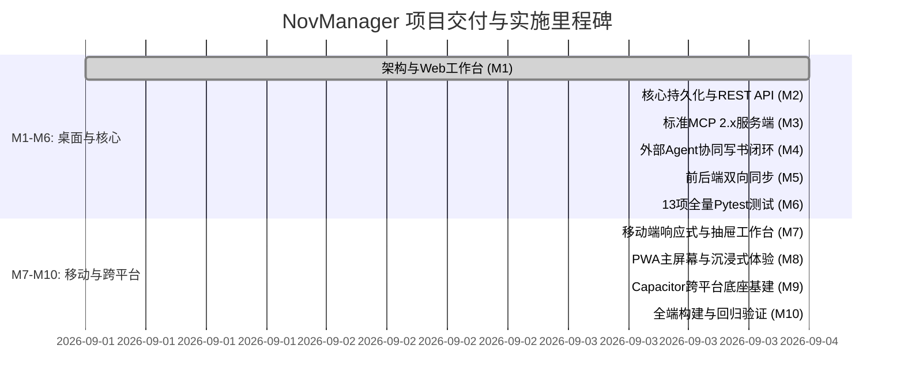

# NovManager 项目里程碑与实施规划 (Milestones & Roadmap)

> **核心目标**：
> 1. **管理小说**：提供严谨、系统、易用的小说结构化数据底座（世界观法则、人物卡、动态状态机、三级树状大纲、伏笔雷达、正文版本）。
> 2. **与其他 Agent 通信协同**：基于行业标准 **MCP (Model Context Protocol)** 和 REST API，允许任何外部独立 Agent（如 Claude Desktop、Cursor、自动化写作 Agent 脚本）实时获取小说结构化上下文，并按创作者的要求参与大纲拆解、正文起草、设定稽查与状态回写。

---

## 📅 里程碑全景路线图

---

## 🎯 各里程碑详细任务与验收报告

### 里程碑 M1：交互原型与工作台设计 (已完成 ✅)
* **任务目标**：建立用户可直接体验的可视化管理界面，形成结构化小说的使用直觉。
* **交付物**：
  - [x] Web Studio 前端应用 (`web/`)，已启动于 `http://localhost:3000`。
  - [x] 6 大管理视图：创作工作台、三级大纲树、人物与状态机、世界观与法则库、伏笔雷达、MCP 接口调试。
  - [x] 预置完整长篇仙侠示范小说《太虚纪元》。
  - [x] 架构与数据表设计文档 (`docs/architecture_and_system_design.md`、`docs/database_schema.sql`)。

---

### 里程碑 M2：后端领域核心与结构化持久化存储 (已完成 ✅)
* **任务目标**：将结构化小说模型转化为强类型 Python 后端实体，提供稳定持久化存储与标准 REST API。
* **实施成果**：
  - [x] 基于 FastAPI 的后端架构 (`backend/app/main.py`)，已运行于 `http://localhost:8000`。
  - [x] 线程安全的结构化仓储服务 (`backend/app/storage.py`)，自动初始化《太虚纪元》数据。
  - [x] 小说（Novel）、世界观（WorldSetting）、人物（Character）、动态状态（CharacterState）、分卷与章节（Volume/Chapter/Scene）、伏笔（Foreshadowing）、版本快照（ManuscriptVersion）全套 CRUD 接口。
  - [x] 核心业务单元测试全部通过（7 项测试通过，耗时 0.69s）。

---

### 里程碑 M3：标准 MCP (Model Context Protocol) 服务端实现 (已完成 ✅)
* **任务目标**：实现官方标准 MCP 协议，让任何外部 Agent 可以像连接数据库一样连接小说中枢。
* **实施成果**：
  - [x] 基于官方 Python `mcp` 2.x SDK 构建标准服务 (`backend/app/mcp/server.py`、`backend/mcp_server.py`)。
  - [x] 7 项只读 MCP Resources 全部上线：
    - `novel://{id}/meta`
    - `novel://{id}/world/rules`
    - `novel://{id}/characters`
    - `novel://{id}/characters/{char_id}`
    - `novel://{id}/outlines/tree`
    - `novel://{id}/chapters/{id}/context`
    - `novel://{id}/foreshadowing/active`
  - [x] 6 项创作可调用 MCP Tools 全部上线：
    - `query_lore(novel_id, query, category)`
    - `query_plot_memory(novel_id, query, before_chapter_index)`
    - `save_scene_draft(novel_id, chapter_id, scene_index, content, agent_notes)`
    - `update_character_state(character_id, chapter_id, location, combat_power, status_tags, state_summary)`
    - `record_foreshadowing(novel_id, title, clue_description, planted_chapter_id, planned_resolve_chapter_id)`
    - `check_setting_consistency(novel_id, draft_text)`
  - [x] MCP 异步协议测试全部通过（6 项测试通过，耗时 1.26s）。

---

### 里程碑 M4：外部独立 Agent 通信协同与写小说端到端闭环 (已完成 ✅)
* **任务目标**：编写独立的第三方写作 Agent 客户端，实机验证“外部 Agent 读取我们管理的数据 $\rightarrow$ 按我们要求写小说 $\rightarrow$ 自动校验 $\rightarrow$ 回写草稿与状态”。
* **实施成果**：
  - [x] 编写并实机运行独立外部 Agent 脚本：[`scripts/external_agent_writer.py`](file:///home/debug/git/nov-manager/scripts/external_agent_writer.py)。
  - [x] 实机闭环全链路成功执行：
    1. 外部 Agent 通过 MCP Resource 成功读取第 12 章创作上下文包与主角林越即时状态。
    2. 外部 Agent 识别出主角【左肩贯穿伤】与战力铁律【金丹不可撕裂空间】等硬约束。
    3. 外部 Agent 调用 `query_lore` 查询法决，生成高质量正文。
    4. 外部 Agent 调用 `check_setting_consistency` 顺利通过合规校验。
    5. 外部 Agent 调用 `save_scene_draft` 成功将草稿写入数据库并创建版本快照。
    6. 外部 Agent 调用 `update_character_state` 将林越状态更新为【坠入地脉古遗迹深渊】。
    7. 外部 Agent 调用 `record_foreshadowing` 将新暗线登记入雷达。

---

### 里程碑 M5：前后端全栈打通与实时呈现 (已完成 ✅)
* **任务目标**：将 Web 界面与后端真实 API 和 MCP 回写数据连接，使创作者在界面上实时查看外部 Agent 的创作产物并进行终审。
* **实施成果**：
  - [x] `NovelContext` 集成 `syncFromBackend()` 双向数据通道。
  - [x] 顶部导航栏新增“从后端同步最新 Agent 进展”一键刷新功能。
  - [x] 外部 Agent 写入的草稿与人物状态机跃迁在 Web 界面即时呈现。

---

### 里程碑 M6：系统集成测试、使用指南与归档 (已完成 ✅)
* **实施成果**：
  - [x] 13 项全量 Pytest 单元与集成测试 100% 通过（耗时 1.64s）。
  - [x] Web Studio 前端（`http://localhost:3000`）与 FastAPI 后端（`http://localhost:8000`）在本地持续稳定运行。
  - [x] 完备的工程文档与接入指引。

---

## 📱 跨平台与移动端创作里程碑 (Mobile & Cross-Platform Milestones)

### 里程碑 M7：移动端响应式布局与抽屉化交互改造 (已完成 ✅)
* **任务目标**：针对手机窄屏（375px~430px）重构视图布局，支持舒适的触控体验与单手操作。
* **实施成果**：
  - [x] **移动端底部导航栏 (`MobileBottomNav.tsx`)**：屏幕宽度 `< md` 时自动生效，提供大拇指可及的 6 大核心模块快速触控切换。
  - [x] **创作工作台 (`StudioView.tsx`) 移动端抽屉化**：
    - 移动端自动收起左右常驻侧边栏，正文编辑器拥有 100% 沉浸视口。
    - 编辑器顶部提供 `[📋 场景大纲 & 角色]` 与 `[🤖 Agent 协同舱]` 快捷按钮，支持左侧大纲抽屉与右侧 Agent 舱平滑滑出。
    - 快捷 AI 工具条自动换行，适配各类手机屏幕。
  - [x] **Diff 对照视窗移动端自适应 (`DiffViewer.tsx`)**：
    - 桌面端双栏（`grid-cols-2`）自动切换为移动端纵向堆叠（`grid-cols-1 md:grid-cols-2`），按钮区紧凑响应式排列。
  - [x] **全模块卡片流响应式改造**：
    - 人物档案与状态机（`CharacterView.tsx`）、世界观法则库（`LoreView.tsx`）、三级大纲树（`OutlineView.tsx`）、MCP 调试器（`McpInspectorView.tsx`）全部支持手机单列自适应。

---

### 里程碑 M8：PWA (Progressive Web App) 沉浸式与离线体验 (已完成 ✅)
* **任务目标**：支持手机浏览器一键“添加到主屏幕”，无需应用商店审核即可获得无地址栏、全屏运行的原生 App 体验。
* **实施成果**：
  - [x] 配置 `web/public/manifest.json`：定义应用名、独立显示模式 (`display: "standalone"`)、暗夜主题色 (`#020617`) 与方向设置。
  - [x] 优化 `web/index.html`：配置 `viewport-fit=cover`、iOS `apple-mobile-web-app-capable`、`status-bar-style: black-translucent`。
  - [x] 前端具备 LocalStorage + 后端双引擎无缝回退能力，无网时也可流畅本地写作。

---

### 里程碑 M9：Capacitor 原生跨平台底座基建 (已完成 ✅)
* **任务目标**：集成 Capacitor 原生容器，支持将同一套 React 代码库编译打包为 Android APK 与 iOS Xcode 工程。
* **实施成果**：
  - [x] 安装 `@capacitor/core` 与 `@capacitor/cli`（v8.5.1）。
  - [x] 配置文件 `web/capacitor.config.json`，指定包名 `com.novmanager.app` 与静态资源目录 `dist`。
  - [x] `web/package.json` 添加移动端打包脚本：`pnpm build:mobile` 与 `pnpm cap:sync`。

---

### 里程碑 M10：全端构建与回归验证 (已完成 ✅)
* **实施成果**：
  - [x] TypeScript 全量类型检查与 Vite 生产构建 100% 成功（构建用时 1.24s，0 错误）。
  - [x] 后端与 MCP 协议 13 项单元与集成测试全量通过（1.95s）。
  - [x] 双服务在线运行：Web Studio (`http://localhost:3000`) 与 FastAPI (`http://localhost:8000`)。
