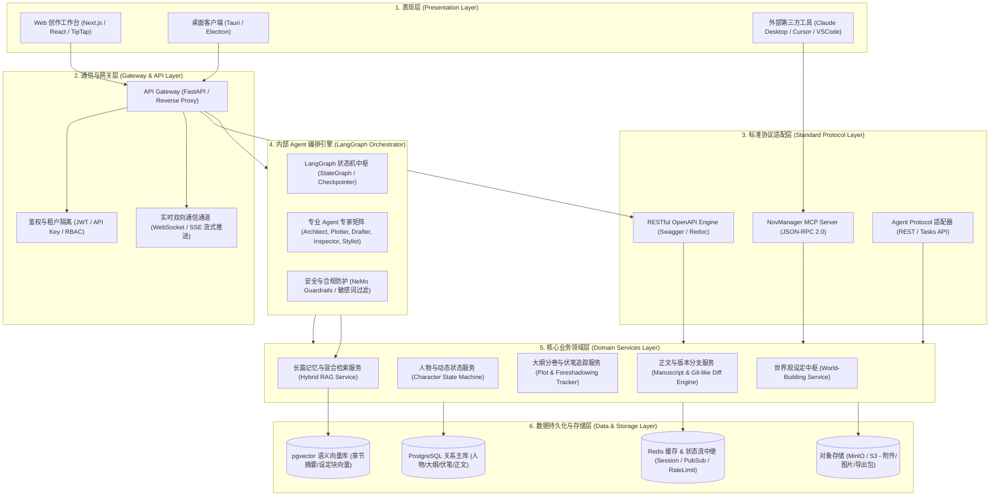
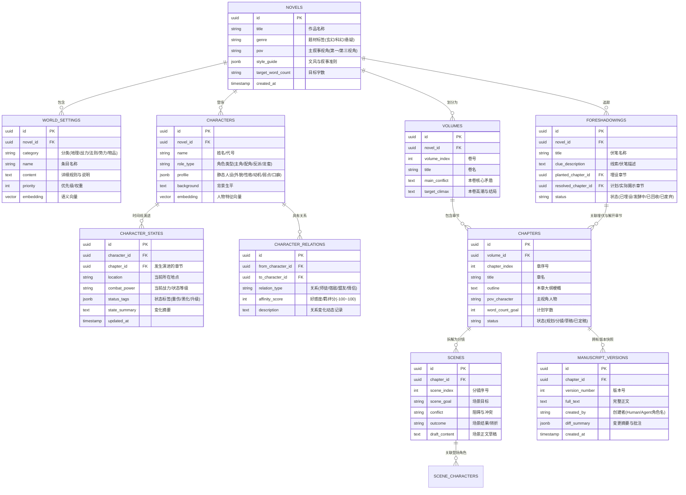
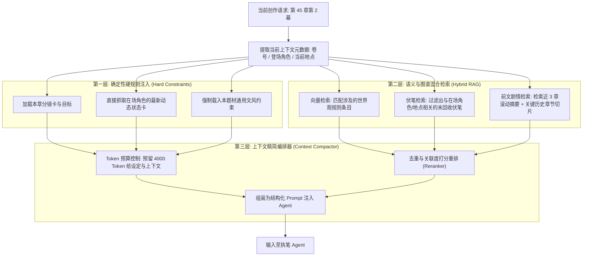
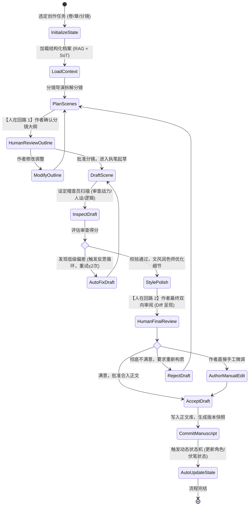
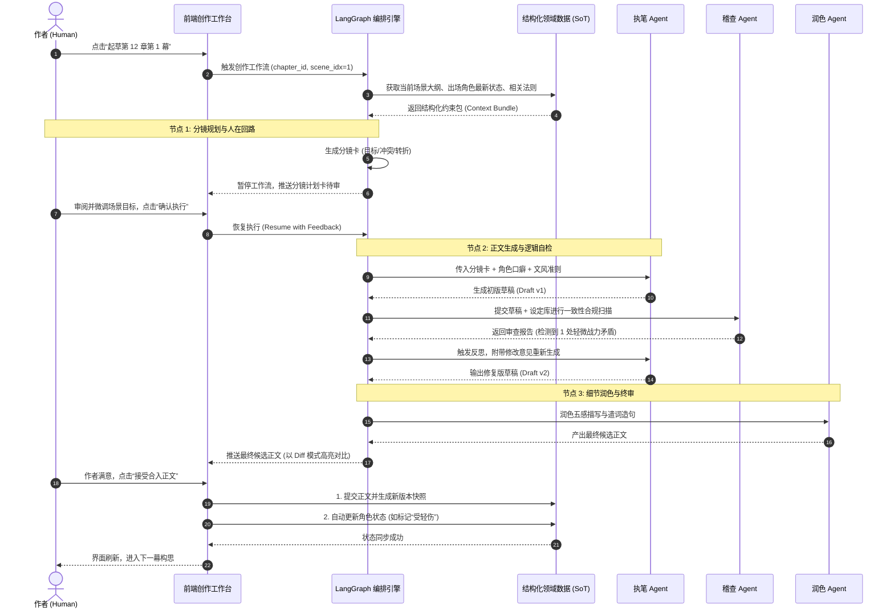
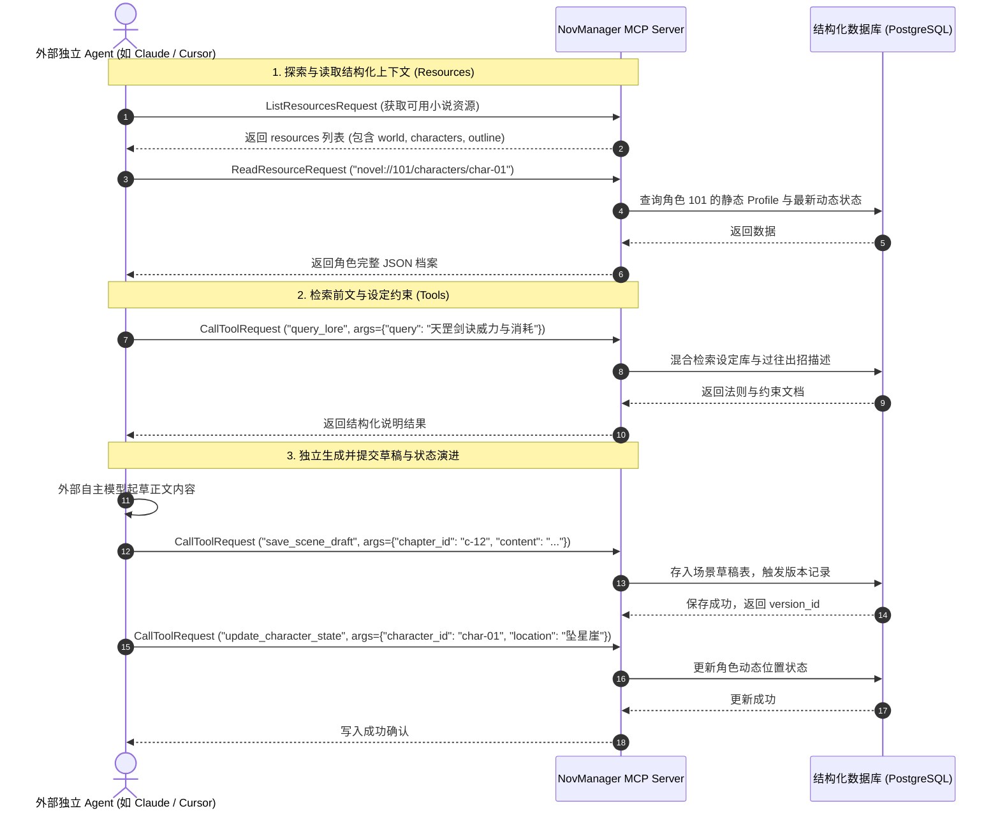

# AI 辅助小说管理与创作平台 (NovManager)
## 整体技术方案与功能模块详细设计规范

---

## 1. 方案背景与系统设计哲学

### 1.1 行业痛点与解决思路
长篇小说创作普遍面临**“三大崩坏”**挑战：
1. **剧情崩**：随着篇幅增长（几十万至数百万字），前后情节矛盾、伏笔遗忘、因果倒置。
2. **人设崩**：角色说话语气变样（OOC - Out of Character）、动机不合逻辑、人际关系错乱。
3. **战力/设定崩**：世界观法则冲突、战力体系越级膨胀、物品规则不一致（“吃设定”）。

通用大模型（LLM）由于上下文窗口限制、记忆衰减以及发散性幻觉，难以直接胜任数十万字长篇小说的结构化构思与严谨撰写。市面上现存工具要么是单纯的“文本编辑器”，缺乏深度的智能体交互；要么是“纯聊天流 AI 写作”，无法进行精细化、结构化的世界观与大纲状态管控。

### 1.2 核心设计哲学
NovManager 确立四大核心设计原则：

```
                 ┌──────────────────────────────────────────┐
                 │       NovManager 核心设计哲学             │
                 └────────────────────┬─────────────────────┘
                                      │
         ┌──────────────────┬─────────┴────────┬──────────────────┐
         ▼                  ▼                  ▼                  ▼
┌─────────────────┐┌─────────────────┐┌─────────────────┐┌─────────────────┐
│ 结构化为基 (SoT) ││ 创作解耦 (Decouple)││ 协议标准化 (MCP)││ 人在回路 (HITL) │
│  App 是唯一状态   ││ 文本与规则解耦   ││ 对接任意外部     ││ 拒绝黑盒，人类   │
│  与真相中枢     ││ 拒绝无序散文输出 ││ 编程/创作 Agent ││ 拥有终审决策权   │
└─────────────────┘└─────────────────┘└─────────────────┘└─────────────────┘
```

1. **结构化为基 (Single Source of Truth, SoT)**：App 是唯一的状态与真相源，所有人物属性、世界观规则、大纲节点、伏笔状态均以关系型/结构化数据存储，而非散落在长文本中。
2. **创作解耦 (Decoupling Content from Structure)**：正文生成与设定管控分离。Agent 在动笔前，必须受严格的结构化约束过滤；生成完毕后，其输出需经过结构化抽取与一致性校验。
3. **协议标准化 (Protocol-First via MCP & OpenAPI)**：对外暴露标准的 **MCP (Model Context Protocol)** 协议与 RESTful OpenAPI，使本系统既可调度内部专用 Agent，也能无缝接入外部任何遵循标准的 Agent（如 Claude Desktop、Cursor、OpenHands、自定义本地 Agent 等）。
4. **人在回路精密可控 (Human-in-the-Loop, HITL)**：长篇创作绝非单向全自动生成，系统在构思、分镜、起草、审校各关键节点设置打断点与仲裁机制，作者随时介入修正。

---

## 2. 总体技术架构设计

### 2.1 系统分层架构图

系统采用现代云原生分层解耦架构，自上而下划分为表现层、API与通信网关层、标准协议适配层、Agent 协同编排层、核心领域服务层以及数据持久化与检索层。



### 2.2 技术栈选型规范

| 架构层级 | 技术选型 | 版本/规范 | 选型理由与核心优势 |
| :--- | :--- | :--- | :--- |
| **后端核心引擎** | **Python (FastAPI)** | Python 3.11+, FastAPI 0.110+ | AI 与 LLM 生态最原生支持；异步高性能；Pydantic v2 提供极速数据校验与 JSON Schema 生成。 |
| **Agent 编排框架** | **LangGraph** | LangGraph 0.2+, LangChain Core | 强状态流转模型（StateGraph）、原生支持 Human-in-the-Loop 状态暂停/恢复、分支容错与重试循环，长篇创作首选。 |
| **多模型调用路由** | **LiteLLM** | LiteLLM 1.40+ | 抹平 DeepSeek、Claude、OpenAI、Ollama 等各类 LLM 接口差异，支持自动负载均衡、重试与 Token 计费监控。 |
| **协议标准接口** | **MCP Python SDK** | MCP 规范最新版 (JSON-RPC 2.0) | Anthropic 主导的标准协议，无缝接入 Cursor、Claude Desktop、OpenHands 等各类生态 Agent。 |
| **主关系型数据库** | **PostgreSQL** | 16+ | 支撑强事务、复杂树状大纲、JSONB 扩展字段，生态极其成熟稳定。 |
| **向量检索数据库** | **pgvector 插件** | 0.7+ | 避免引入额外专用向量库运维负担，一套 PostgreSQL 同时搞定事务关系数据与剧情向量检索，支持混合过滤。 |
| **缓存与消息中继** | **Redis** | 7.2+ | 缓存会话状态、管理高频分布式锁、支持流式 SSE 消息队列分发。 |
| **前端应用界面** | **Next.js + React + TipTap** | Next.js 14 (App Router), TipTap 2.x | 极佳的富文本定制能力（支持行内批注、Diff 对比、高亮实体）、响应式分栏工作台。 |

---

## 3. 领域数据模型与数据库详细设计

### 3.1 实体关系图 (E-R Diagram)



### 3.2 混合长篇记忆与检索机制 (Hybrid RAG)

长篇小说记忆衰减是 AI 创作的核心痛点。NovManager 摒弃“一股脑塞整个上下文”的做法，设计**三层漏斗式长篇记忆检索链**：



---

## 4. MCP (Model Context Protocol) 统一对接层详细设计

为了让**各种外部或自定义编程 Agent**（无论是用户本地跑的 Claude Code、Cline、Cursor，还是运行在云端的自动化 Agent）都能像与本地项目交互一样与 NovManager 通信，NovManager 提供符合标准的 **MCP Server (Model Context Protocol)**。

### 4.1 MCP 资源体系 (Resources)
资源提供只读的结构化数据，外部 Agent 可以像读取本地虚拟文件一样访问小说的各类档案。

| Resource URI 规范 | MIME 类型 | 数据说明 | 典型返回示例 |
| :--- | :--- | :--- | :--- |
| `novel://{novel_id}/meta` | `application/json` | 小说元数据与核心指导风格 | `{"title": "太虚纪元", "genre": "修真玄幻", "style": "冷峻简练"}` |
| `novel://{novel_id}/world/rules` | `application/json` | 全局法则与战力体系清单 | `[{"category": "战力", "name": "金丹期", "rules": "神识离体，不可凌空瞬移"}]` |
| `novel://{novel_id}/characters` | `application/json` | 全部角色简要卡列表 | `[{"id": "char-01", "name": "林越", "role": "主角", "status": "筑基后期"}]` |
| `novel://{novel_id}/characters/{char_id}` | `application/json` | 单个角色的深度档案与历史演进 | 包括性格特质、语言风格、好感度网络、目前所持道具与心理状态 |
| `novel://{novel_id}/outlines/tree` | `application/json` | 卷-章-分镜完整大纲树 | 包含每卷每章的冲突要点与当前完成状态 |
| `novel://{novel_id}/chapters/{chapter_id}/context` | `application/json` | 针对特定章节的预装配上下文包 | 该章的目标、出场角色卡、前情摘要、待呼应伏笔 |
| `novel://{novel_id}/foreshadowing/active` | `application/json` | 当前小说中所有处于“已埋设”状态的伏笔清单 | 用于 Agent 在构思新章节时进行回收利用 |

### 4.2 MCP 工具接口清单 (Tools)
工具允许 Agent 主动向系统查询知识、校验逻辑或提交创作产物。

```
┌────────────────────────────────────────────────────────────────────────┐
│                         NovManager MCP Tools 矩阵                      │
├────────────────────────────────┬───────────────────────────────────────┤
│ 1. 知识与检索类 (Query)        │ 2. 创作与写入类 (Mutation)            │
│   • query_lore                 │   • save_scene_draft                  │
│   • query_character_history    │   • update_character_state            │
│   • search_plot_memory         │   • record_foreshadowing              │
├────────────────────────────────┼───────────────────────────────────────┤
│ 3. 校验与审查类 (Validation)   │ 4. 大纲与结构操作类 (Structure)       │
│   • check_setting_consistency  │   • create_chapter_outline            │
│   • lint_character_voice       │   • update_scene_breakdown            │
└────────────────────────────────┴───────────────────────────────────────┘
```

#### 关键工具 JSON Schema 定义示例

##### 工具 1：`save_scene_draft` (提交分镜草稿)
```json
{
  "name": "save_scene_draft",
  "description": "保存指定章节下某个分镜的正文草稿，系统会自动记录版本并生成差异对比",
  "parameters": {
    "type": "object",
    "properties": {
      "novel_id": { "type": "string", "description": "小说全局唯一ID" },
      "chapter_id": { "type": "string", "description": "章节ID" },
      "scene_index": { "type": "integer", "description": "分镜序号，从 1 开始" },
      "content": { "type": "string", "description": "生成的正文草稿内容（Markdown格式）" },
      "agent_notes": { "type": "string", "description": "Agent创作备注文档，说明本段推进了哪些情节或埋下了什么细节" }
    },
    "required": ["novel_id", "chapter_id", "scene_index", "content"]
  }
}
```

##### 工具 2：`update_character_state` (更新角色动态状态)
```json
{
  "name": "update_character_state",
  "description": "在剧情推进后，更新角色的即时物理/心理状态，保持时间线演进连续性",
  "parameters": {
    "type": "object",
    "properties": {
      "character_id": { "type": "string", "description": "角色ID" },
      "chapter_id": { "type": "string", "description": "发生改变的最新章节ID" },
      "location": { "type": "string", "description": "最新所处地理位置" },
      "combat_power": { "type": "string", "description": "最新境界/战力状态" },
      "status_tags": { 
        "type": "array", 
        "items": { "type": "string" },
        "description": "新增或更新的状态标签，如 ['左臂负伤', '心境受损', '突破在即']" 
      },
      "state_summary": { "type": "string", "description": "简述本章中该角色经历的关键转折" }
    },
    "required": ["character_id", "chapter_id", "state_summary"]
  }
}
```

##### 工具 3：`check_setting_consistency` (一致性检验工具)
```json
{
  "name": "check_setting_consistency",
  "description": "传入一段正文草稿，根据小说的设定库与人物档案进行自动化合规性扫描，发现吃设定或OOC问题",
  "parameters": {
    "type": "object",
    "properties": {
      "novel_id": { "type": "string", "description": "小说全局唯一ID" },
      "draft_text": { "type": "string", "description": "待检测的正文草稿文本" },
      "involved_character_ids": { 
        "type": "array", 
        "items": { "type": "string" },
        "description": "本段草稿中出场的主要角色ID列表" 
      }
    },
    "required": ["novel_id", "draft_text"]
  }
}
```

### 4.3 外部 Agent 接入配置方式
外部工具（如 Claude Desktop 或 Cursor）只需在 `claude_desktop_config.json` 中添加如下配置，即可直接控制小说工程：

```json
{
  "mcpServers": {
    "nov-manager": {
      "command": "python",
      "args": ["-m", "nov_manager.mcp_server", "--port", "8765"],
      "env": {
        "NOV_API_KEY": "nov_sec_99a8b7c6d5e4f3a2",
        "NOV_SERVER_URL": "http://localhost:8000"
      }
    }
  }
}
```

---

## 5. 内部多 Agent 编排引擎设计 (基于 LangGraph)

系统内部提供开箱即用的专业创作编排工作流。采用 **LangGraph** 实现具备强状态管理、反思修正循环与人工断点的状态机。

### 5.1 专家 Agent 角色矩阵分工

| 角色 Agent | 职责定义 | 输入上下文 | 核心输出 |
| :--- | :--- | :--- | :--- |
| **世界架构师 (Architect)** | 负责扩充设定库、制定战力等级阶梯、确保世界法则自洽。 | 世界观大类、作者原始灵感片段 | 结构化 WorldSetting JSON 对象 |
| **剧情总监 (Plotter)** | 负责编排分卷核心矛盾、章节节拍点（Beats）以及伏笔埋设与回收。 | 全书核心梗概、已完成章节简报 | 章节大纲（Chapter Outline）、伏笔计划卡 |
| **分镜导演 (Director)** | 将单章大纲细化为 3~5 个具象分镜场景（目标-阻碍-转折-结果）。 | 单章大纲、登场角色卡、当前环境 | 分镜卡（Scene Breakdown Cards） |
| **正文执笔员 (Drafter)** | 负责将分镜卡转化为生动的正文，严格遵守视角限制与文风指引。 | 分镜卡、角色性格与口癖、文风范例 | 场景正文草稿（Markdown 正文） |
| **设定稽查员 (Inspector)** | 专注于找茬：对比正文与数据库档案，核查逻辑漏洞、战力越级、人物 OOC。 | 场景正文草稿、世界设定库、人物卡 | 结构化审查报告（评分、违规项列表、修改意见） |
| **文风润色师 (Stylist)** | 优化行文节奏、消除 AI 味与重复句式、增强五感描写与环境烘托。 | 场景正文草稿、审查意见、文风准则 | 优化后的最终候选正文 |

### 5.2 编排状态机与工作流设计 (LangGraph Stateflow)



### 5.3 状态数据契约 (State Schema)

LangGraph 节点间共享的 `NovelWritingState` 结构：

```python
from typing import TypedDict, List, Dict, Optional, Any

class SceneCard(TypedDict):
    scene_index: int
    goal: str             # 场景目标
    conflict: str         # 核心冲突
    turn_point: str       # 转折点
    outcome: str          # 结果
    involved_characters: List[str]
    draft_content: Optional[str]

class InspectionIssue(TypedDict):
    issue_type: str       # "SETTING_VIOLATION" | "OOC" | "PLOT_HOLE" | "TYPO"
    severity: str         # "CRITICAL" | "WARNING" | "SUGGESTION"
    location_snippet: str # 出问题的原文片段
    explanation: str      # 违规原因分析
    fix_advice: str       # 修改建议

class NovelWritingState(TypedDict):
    # 基础定位元数据
    novel_id: str
    volume_id: str
    chapter_id: str
    
    # 结构化上下文 (从 SoT 数据库加载)
    style_guideline: Dict[str, Any]
    characters_context: List[Dict[str, Any]]
    world_rules_context: List[Dict[str, Any]]
    active_foreshadowings: List[Dict[str, Any]]
    previous_summary: str
    
    # 过程产物
    scene_cards: List[SceneCard]
    current_scene_index: int
    raw_draft: str
    inspection_report: List[InspectionIssue]
    retry_count: int
    polished_draft: str
    
    # 人机交互与最终决策
    human_feedback: Optional[str]
    is_approved: bool
    final_text: Optional[str]
```

---

## 6. 功能模块详细设计

系统共规划 7 大核心功能模块，形成“设定-大纲-创作-审校-版本-生态”的完整业务闭环。

```
┌────────────────────────────────────────────────────────────────────────┐
│                        NovManager 七大功能模块体系                      │
├────────────────────────────────┬───────────────────────────────────────┤
│ 模块 1: 结构化世界观与设定中枢 │ 模块 2: 动态人物卡与关系演进追踪      │
│  (Lore & World-Building Hub)   │  (Character State & Relation Graph)   │
├────────────────────────────────┼───────────────────────────────────────┤
│ 模块 3: 三级树状大纲与伏笔雷达 │ 模块 4: 双向 Agent 沉浸式创作工作台   │
│  (Tree Outline & Plot Radar)   │  (Dual-Pane Contextual Editor)        │
├────────────────────────────────┼───────────────────────────────────────┤
│ 模块 5: 剧情一致性与防崩盘中枢 │ 模块 6: 多模型路由与提示词工坊        │
│  (Continuity & Consistency Guard)│  (Model Gateway & Prompt Registry)    │
├────────────────────────────────┴───────────────────────────────────────┤
│ 模块 7: 开放生态网关与版本溯源 (MCP & Version Control Engine)          │
└────────────────────────────────────────────────────────────────────────┘
```

### 6.1 模块 1：结构化世界观与设定中枢 (Lore & World-Building Hub)
- **多层级分类管理**：支持“地理气候”、“战力境界”、“势力阵营”、“武功/魔法法则”、“宝物/道具”分类卡片。
- **实体属性模板**：每类设定支持灵活表单字段（如战力境界包含：寿命上限、代表能力、突破条件、克制要素）。
- **设定防撞库检索**：新增设定时，Agent 自动检测是否与既有法则产生悖论。
- **关联引用热词**：编辑器内输入 `@` 即可唤起设定卡悬浮窗，快速引用并固定锚点。

### 6.2 模块 2：动态人物卡与人际关系演进追踪 (Character State Machine)
- **双层档案体系**：
  - **静态人设（固有层）**：姓名、生辰、外貌特征、深层心理创伤、核心人生目标、语言风格（口癖、用词偏好）。
  - **动态演进（时间轴层）**：随着章节推进，记录角色的健康状况、战力变化、所持物品、心境演化，形成“角色状态时间线”。
- **人际网络拓扑图**：动态展示角色间的好感度与关系（如师徒、背叛、恋人、盟友），支持按章节回溯不同时间节点的关系变化。

### 6.3 模块 3：三级树状大纲与多线伏笔雷达 (Tree Outline & Plot Radar)
- **三级创作骨架**：卷（Volume，总览大矛盾） $\rightarrow$ 章（Chapter，推进小目标） $\rightarrow$ 分镜（Scene，执行具体对抗）。
- **多情节线追踪**：支持主线、副线（如恋爱线、修炼线、悬疑线）在时间轴上的并行泳道图展示。
- **伏笔生命周期看板**：
  - 四态管理：`[待埋设]` $\rightarrow$ `[已埋设/暗线潜伏]` $\rightarrow$ `[回收提示]` $\rightarrow$ `[已揭示/已回收]`。
  - 自动预警：当某一伏笔超过设定的章节阈值仍未回收时，系统提示作者或 Agent 进行情节呼应。

### 6.4 模块 4：双向 Agent 沉浸式创作工作台 (Dual-Pane Contextual Editor)
- **三栏布局交互**：
  - **左栏（结构与上下文）**：大纲树导航、在场角色快速状态预览、当前场景目标卡片、相关伏笔提醒。
  - **中栏（沉浸式编辑器）**：基于 TipTap 开发的富文本/Markdown 编辑器，支持双向光标、段落级 AI 改写扩写、行内 Diff 审阅对比。
  - **右栏（Agent 协作与对话舱）**：显示当前执行的工作流状态节点，允许与“设定稽查员”、“润色师”进行针对性质询和指令下发。

### 6.5 模块 5：剧情一致性与防崩盘中枢 (Continuity & Consistency Guard)
- **断言式规则引擎**：在每次草稿生成后执行硬规则匹配（例如：主角当前处于“经脉尽断”状态，若正文中出现“御剑飞天”，立即拦截报错）。
- **人物语气一致性分析 (OOC 检测)**：抽取正文中的对话句，结合角色 Profile 中的语言习惯指标打分，防止高冷角色突然说出轻浮用语。
- **长篇因果链溯源**：提供反向追溯面板，点击正文中的某句话，即可查看该情节依据前文哪一条设定或伏笔展开。

### 6.6 模块 6：多模型路由与提示词工坊 (Model Gateway & Prompt Registry)
- **模型梯队分工**：
  - **复杂推理模型（如 DeepSeek-R1 / Claude 3.5 Sonnet / GPT-4o）**：用于架构规划、分镜拆解、深度逻辑审校。
  - **高性价比模型（如 DeepSeek-V3 / Qwen-2.5 / Claude Haiku）**：用于正文大段起草、文风初润色、向量摘要提炼。
- **提示词版本管理**：每位专家 Agent 的 System Prompt 支持灰度测试、版本回滚与变量动态注入。

### 6.7 模块 7：开放生态网关与版本溯源 (MCP & Version Control Engine)
- **标准 MCP 端点暴露**：支持以 Stdio 本地管道或 SSE 远程服务端形式对外开放小说资源与工具。
- **Git-like 细粒度版本快照**：每次草稿变更均生成版本快照（Snapshot），不仅记录文本 Diff，还同步记录产生该文本时的“Agent 思考链与提示词参数”，确保所有创作历史可复现、可回滚。

---

## 7. 典型业务交互时序图

### 7.1 场景一：系统内部 Agent 自动化章节创作闭环 (带人工审核)



### 7.2 场景二：外部 Agent 通过 MCP 协议对接创作

外部第三方 Agent（如用户在本地终端运行的独立自主智能体）如何与 NovManager 交互：



---

## 8. 非功能性架构设计与落地规划

### 8.1 性能优化与高并发处理
1. **长文本 Token 预算动态剪裁**：
   - 设定严格的上下文窗口配额：设定库注入上限 2000 Tokens，人物卡注入上限 1500 Tokens，前情摘要上限 1000 Tokens。超过阈值时采用 Reranker 基于相似度只保留 Top-K 切片。
2. **全异步任务队列架构**：
   - 大纲生成、整章起草等长耗时操作全量接入异步任务队列（Celery 或 Redis ARQ），前端通过 WebSocket / SSE 订阅生成进度与 Token 流式输出。
3. **混合多级缓存策略**：
   - 世界观设定与核心主角 Profile 属于高频只读数据，直接加载至 Redis 内存缓存；仅在作者触发更新时淘汰对应 Cache 键。

### 8.2 数据安全性与版权保护
1. **Git 思想的快照版本控制 (VCS)**：
   - 所有的正文变动以分块（Chunk）形式保存版本记录，支持无限级撤回、分支创建（“剧情平行宇宙尝试”）与安全回滚，彻底杜绝数据意外覆盖丢失。
2. **敏感词与内容安全前置过滤**：
   - 在 Agent 输出写入正文库之前，集成敏感词合规字典与语义审核模块，提前标记违规内容并给作者提供修改建议。

### 8.3 推荐代码工程目录结构

```text
nov-manager/
├── docs/                               # 架构设计、接口文档与规范说明
│   ├── architecture_and_system_design.md
│   ├── database_schema.sql
│   └── mcp_specification.json
├── backend/                            # 后端核心服务 (FastAPI)
│   ├── app/
│   │   ├── api/                        # RESTful OpenAPI 路由
│   │   │   └── v1/
│   │   │       ├── novels.py
│   │   │       ├── characters.py
│   │   │       ├── outlines.py
│   │   │       └── manuscripts.py
│   │   ├── core/                       # 核心配置、数据库连接、安全
│   │   ├── domain/                     # 领域实体与业务逻辑
│   │   │   ├── characters/
│   │   │   ├── lore/
│   │   │   ├── plot/
│   │   │   └── manuscript/
│   │   ├── mcp/                        # MCP Server 协议实现
│   │   │   ├── server.py               # MCP Server 入口
│   │   │   ├── resources.py            # Resource 处理器
│   │   │   └── tools.py                # Tools 注册与调度
│   │   ├── orchestrator/               # LangGraph 编排引擎
│   │   │   ├── graph.py                # 状态机定义
│   │   │   ├── state.py                # 状态字典定义
│   │   │   ├── agents/                 # 专家 Agent 实现
│   │   │   │   ├── architect.py
│   │   │   │   ├── plotter.py
│   │   │   │   ├── drafter.py
│   │   │   │   ├── inspector.py
│   │   │   │   └── stylist.py
│   │   │   └── prompts/                # 提示词模板与版本控制
│   │   └── rag/                        # 混合检索与向量库交互
│   ├── pyproject.toml
│   └── Dockerfile
├── frontend/                           # 前端交互工作台 (Next.js)
│   ├── src/
│   │   ├── app/                        # 页面路由
│   │   ├── components/                 # UI 组件
│   │   │   ├── editor/                 # TipTap 富文本编辑器
│   │   │   ├── outline/                # 树状大纲与甘特图
│   │   │   ├── characters/             # 人物卡与关系图谱
│   │   │   └── agent-dock/             # Agent 协作抽屉面板
│   │   └── lib/                        # API 客户端与状态管理
│   ├── package.json
│   └── tailwind.config.js
├── docker-compose.yml                  # 本地全栈开发编排环境
└── README.md                           # 工程说明
```

### 8.4 项目落地实施三阶段路线图 (Roadmap)

```
2026 Q3 (Phase 1: MVP 结构化底座)
  ├── 搭建 PostgreSQL + pgvector 结构化数据核心
  ├── 完成小说元数据、设定库、人物卡、卷章树 CRUD
  ├── 实现基础 TipTap 富文本双向编辑器
  └── 打通单 Agent (Drafter) 带上下文的起草生成

2026 Q4 (Phase 2: 编排闭环与 MCP 协议栈)
  ├── 落地 LangGraph 多 Agent 编排流水线 (起草 -> 稽查 -> 润色)
  ├── 引入人在回路 (HITL) 分镜审批与 Diff 差异审阅功能
  ├── 完整发布 NovManager MCP Server (支持 Resources 与核心 Tools)
  └── 对接外部 Claude Desktop / Cursor 实现在第三方环境编写与同步

2027 Q1 (Phase 3: 智能进阶与商业级创作套件)
  ├── 升级角色动态状态机与人物关系拓扑网动态演算
  ├── 推出“平行宇宙”剧情分支对比探索模式
  ├── 强化剧情防崩盘断言引擎与深度 OOC 评分
  └── 支持一键多格式导出 (Epub/PDF/Markdown/有声剧脚本)
```
