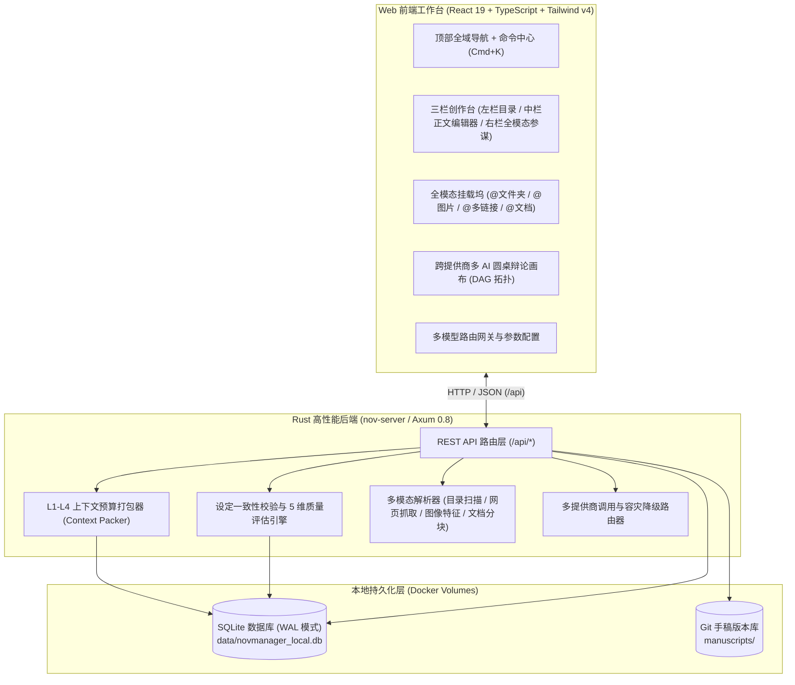

# 系统架构与工程设计文档 (Architecture & System Design)

本文档说明 **墨枢（InkVerse / NovManager）** 的整体技术架构、核心子系统划分、数据流设计以及容器化部署方案。

---

## 1. 总体架构概览

系统采用 **本地优先（Local-First）** 的前后端分离与容器化架构，由 **React 19 前端工作台** 与 **Rust (`Axum`) 后端服务** 组成：

---

## 2. 核心子系统设计

### 2.1 三栏定住式创作台与独立滚轮隔离 (`StudioView`)
为了解决长篇写作中“目录、正文、AI 对话互相抢占滚动条”的问题，工作台采用固定视口容器设计：
1. **外层视口锁定**：`App.tsx` 使用 `h-screen w-screen overflow-hidden flex flex-col`，禁止浏览器级全局滚动。
2. **三栏独立布局**：
   - **左栏 (`ContextDrawer`)**：顶部作品概况与底部快捷入口固定（`shrink-0`），中间章节树与前文提要区域设置 `flex-1 min-h-0 overflow-y-auto overscroll-contain`。
   - **中栏 (`ManuscriptEditor`)**：顶部幕次切换栏与底部编辑器状态栏固定（`shrink-0`），中间稿纸区域独立滚动。4 维场景大纲卡片默认折叠为单行摘要条，最大化正文可视面积。
   - **右栏 (`AgentDock`)**：顶部多模态范式切换器与底部多功能输入框固定（`shrink-0`），中间对话流与稽查报告独立滚动。

### 2.2 全模态上下文摄取与协同机制
在创作讨论或正文改写时，系统支持将多种外部参考源组装进 Prompt 上下文：
1. **文件夹递归扫描（Claude Code 模式）**：扫描指定设定目录，过滤隐藏文件与构建产物，按文件类型提取摘要并计算脱水后 Token 占用。
2. **行内精准补丁（Codex 模式）**：针对当前编辑器正文中的目标段落生成结构化替换块（`targetSnippet` → `replacementSnippet`），支持在聊天流中一键替换至编辑器。
3. **图像视觉信息提取（ChatGPT Vision 模式）**：支持文件上传、拖拽或剪贴板 `Ctrl+V` 贴图，提取场景构图、光影氛围与 OCR 文字，辅助生成环境与外貌描写。
4. **多链接并发抓取（WorkBuddy 模式）**：并发请求多条参考 URL，剥离 HTML 标签噪音并汇总关键事实。

### 2.3 跨提供商多智能体圆桌（Multi-Agent Council）
- **节点与连线模型**：每个 Agent 节点包含独立的系统提示词（System Prompt）、温度参数、绑定模型提供商（Provider）及角色定位。
- **执行流程**：支持按拓扑顺序依次发言、交叉评议，最终由汇总节点（Synthesizer）输出融合各方意见的定稿文本或修订方案。

### 2.4 数据存储与版本控制
1. **SQLite WAL 存储引擎 (`backend_rust/src/storage.rs`)**：
   - 维护 `novels`、`volumes`、`chapters`、`scenes`、`characters`、`character_states`、`world_settings`、`foreshadowing`、`model_providers`、`style_dna_profiles`、`video_storyboards` 等核心表。
   - 开启 `PRAGMA journal_mode = WAL;`，保障读写并发性能与数据完整性。
2. **Git 手稿快照 (`backend_rust/src/git_vcs.rs`)**：
   - 每次关键保存或阶段性定稿可自动触发 Git 快照提交，支持按 Commit Hash 查询历史记录与版本差异。

---

## 3. 容器化与 OrbStack 部署设计

项目通过 `docker-compose.yml` 编排两个轻量服务：
1. **`inkverse-backend` (`./backend_rust/Dockerfile`)**：
   - 采用 Rust 官方镜像编译发行版二进制 `nov-server`，运行阶段基于精简 Debian 镜像，内置 `git` 与 `curl`。
   - 监听 `8000` 端口，挂载 `./data:/app/data` 与 `./manuscripts:/app/manuscripts`。
2. **`inkverse-web` (`./web/Dockerfile`)**：
   - 构建阶段使用 Node + pnpm 编译前端静态产物（`dist/`）。
   - 运行阶段使用 `nginx:alpine` 托管静态资源，并将 `/api/*` 请求反向代理至 `http://backend:8000/api/`，对外暴露 `3000` 端口。
