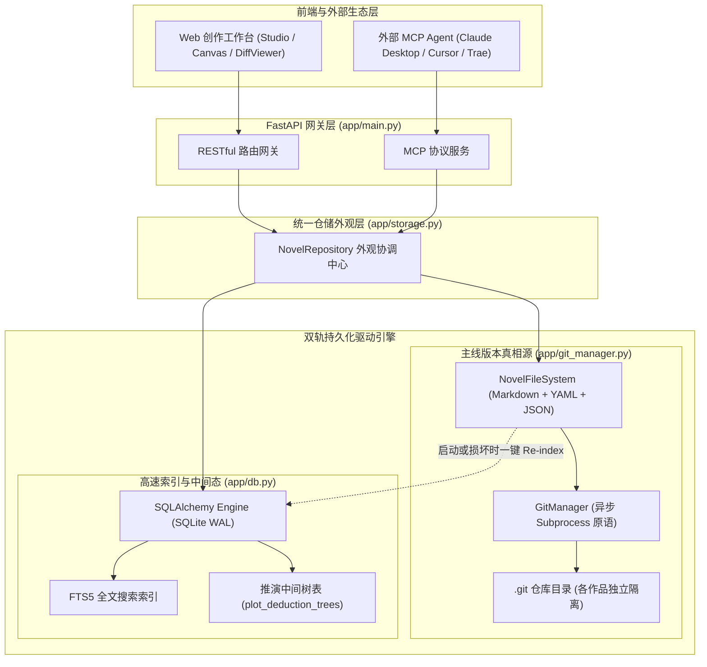
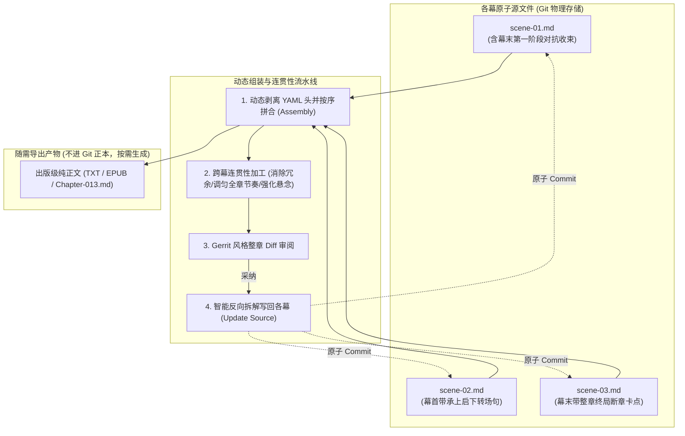

# NovManager 2.0 架构重构设计文档：Git 工程底座 + SQLite 高速索引缓存

## 一、 重构背景与核心设计原则

### 1.1 痛点与演进驱动
在 NovManager 1.0 阶段，系统设计最初预设了“云端 SaaS 协同中台”模式，选型了 **PostgreSQL 16 + pgvector**。但在单机、个人作家及小团队深度创作的实际使用中，暴露出以下摩擦：
1. **部署门槛沉重**：创作者需安装并维护外部 PostgreSQL 守护进程、配置账号密码及端口，导致日常开发和运行极度依赖脆弱的 `novel_store.json` fallback；
2. **数据缺乏透明主权**：小说文本与人设深锁在关系库二进制中，脱离平台无法直接用通用工具（VS Code、Obsidian、Typora）检视和编辑；
3. **版本控制缺失工程级底座**：仅靠数据库表存历史字符串，无法天然支撑多分支剧情推演、版本标签（Tag）、主线合并与分布式灾备。

### 1.2 2.0 核心设计哲学
- **Local-First（本地优先）**：零配置秒级启动，所有核心资产以纯文本物理文件形式归创作者所有；
- **Git Under the Hood（Git 原生底座，操作透明）**：将小说视为标准 Git 工程，底层全自动触发原子 Commit，绝不让创作者感知终端命令行或冲突符号；
- **推演是沙盒，主线是工程**：画布上的发散推演作为中间态保存在轻量数据库/缓存中，唯有作者确认采纳的正文才原子化落盘并 Commit；
- **双轨分工与一键自愈**：Git 仓库是不可撼动的**唯一真相源（Source of Truth）**，SQLite 充当**只读加速与查询索引（Query Index & Cache）**。即使 SQLite 损坏或删除，数秒内即可由 Git 仓库反向重建。

---

## 二、 总体系统架构与模块边界



### 模块职责界定

| 模块名称 | 所在路径 | 核心职责 |
| :--- | :--- | :--- |
| **`GitManager`** | `backend/app/git_manager.py` | 封装原生 `git` 异步子进程操作：仓库 `init`、`add`、`commit`、`log`、`status`，支持自定义提交者身份。 |
| **`NovelFileSystem`** | `backend/app/file_system.py` | 负责磁盘物理目录树布局，将 Scene 转为带 YAML 头部的 Markdown，将设定、人物转为清晰的 JSON。 |
| **`DatabaseManager`** | `backend/app/db.py` | 基于 SQLite（开启 WAL 模式）实现关系查询、FTS5 全文索引、推演幕布临时节点树存储。保留环境变量切换 Postgres 能力。 |
| **`NovelRepository`** | `backend/app/storage.py` | 统一外观对象（Facade）。写操作触发“落盘 -> Git Commit -> 更新 SQLite 缓存”；读操作优先从 SQLite 毫秒级返回。 |

---

## 三、 小说 Git 项目目录规范与文件格式

每个小说拥有一个独立的项目目录：`backend/data/projects/{novel_id}/`（支持自定义路径或移动）。

### 3.1 物理目录结构
```text
projects/{novel_id}/
├── .git/                           # 独立的 Git 版本仓库
├── .gitignore                      # 忽略临时导出与缓存
├── novel.json                      # 全书元数据 (书名、题材、文风准则、字数目标)
├── settings/                       # 世界观设定词条库
│   ├── rules.json                  # 天道法则与战力体系
│   └── factions.json               # 宗门势力与地理分布
├── characters/                     # 人物核心档案与状态机
│   ├── char-001.json               # 主角基础档案卡 (姓名、前史、性格缺陷)
│   ├── char-002.json               # 关键配角基础档案卡
│   └── states.jsonl                # 逐章状态演进流 (按行记录，防合并冲突)
├── relations.json                  # 角色好感度与人际拓扑图谱
├── foreshadowings.json             # 伏笔生命周期追踪表
├── techniques.json                 # 沉淀的文学润色技巧资产库
└── manuscript/                     # 正文正本工程目录
    └── volume-01/                  # 分卷目录
        ├── volume.json             # 卷大纲、核心冲突、出场边界与防早现约束
        ├── chapter-001/            # 章节目录
        │   ├── chapter.json        # 章节细纲、POV 视点角色、字数目标
        │   ├── scene-01.md         # 第 1 幕工笔正文 (带 YAML 元数据头)
        │   ├── scene-02.md         # 第 2 幕工笔正文
        │   └── scene-03.md         # 第 3 幕工笔正文
        └── chapter-002/
            ├── chapter.json
            └── scene-01.md
```

### 3.2 分镜正文文件标准（`scene-01.md`）
采用业界通用的 **Markdown + YAML Frontmatter** 格式，人类可读且通用编辑器（Obsidian、Typora）原生高亮渲染：
```markdown
---
id: "sc-13-1"
chapter_id: "chap-013"
scene_index: 1
scene_goal: "林越与苏青瑶在地渊幽暗古殿中苏醒，相互戒备中确认彼此伤势"
conflict: "地脉深渊灵气紊乱，古禁制蠢蠢欲动"
turn_point: "苏青瑶的秋泓剑鞘与林越青铜残片产生共振"
outcome: "发现地底巨大残阵轮廓，决定结伴探索生路"
characters:
  - "char-001"
  - "char-002"
location: "地渊上古遗迹外殿"
agent_notes: "开启地底探险新篇章"
---

冰冷刺骨的水滴，一滴一滴落在林越眉心。

他猛地睁开双眼，右手本能地握住腰间残剑，整个人瞬间翻滚戒备。然而牵动左肩的伤口，让他忍不住倒抽了一口凉气。

“林师兄……你醒了？”

微弱的声音从数步外的碎石堆后传来。苏青瑶面容微白，衣裙多处被罡风划破，发髻散乱，却依然挣扎着执剑站直……
```

### 3.3 人物状态流文件（`characters/states.jsonl`）
采用 **JSON Lines（每行一个记录）**，避免数组扩充时的 Git 行冲突，天然适配时间轴回溯：
```jsonl
{"character_id":"char-001","chapter_id":"chap-001","chapter_index":1,"location":"太虚门外门执事堂","combat_power":"炼气期三重","health_status":"HEALTHY","status_tags":["藏拙","隐忍"],"state_summary":"表面平平无奇，暗中参悟残片","updated_at":"2026-08-01T08:00:00Z"}
{"character_id":"char-001","chapter_id":"chap-013","chapter_index":13,"location":"地渊上古遗迹外殿","combat_power":"炼气期九重巅峰","health_status":"INJURED","status_tags":["左肩剑伤","灵力枯竭"],"state_summary":"斩杀强敌坠入地渊，秋泓剑鞘产生异动共鸣","updated_at":"2026-09-06T01:30:00Z"}
```

### 3.4 分镜（Scene）与整章正文（Chapter）的装配与转场缝合机制

在小说工程化管理中，**分镜正文（`scene-n.md`）是唯一源本（Single Source of Truth），整章正文是动态组装与编译视图（Assembly View）**。如果直接简单拼接，容易产生时空断层与冗余重申；如果同时存储 `chapter.md` 和 `scene-n.md`，则会引发双向同步与合并冲突灾难。

为此，系统确立以下三大标准机制：



#### ① 转场内化原则（Transition In-Scene）
在规范化分镜正文编写中，“幕首入景”与“幕末收束”本身即属于该分镜正文的有机组成部分：
- **`scene-01.md`**：以本章切入点自然开篇；
- **非第 1 幕（如 `scene-02.md`）**：首句由 Drafter Agent 或作者自然承担**时空推进桥梁**（例如：“穿过倒塌的玉柱廊道，两人行了约莫半柱香功夫……”），避免场景突变断层；
- **终局幕（如 `scene-03.md`）**：末尾天然承担全章的最终悬念钩子（Hook）。

#### ② 跨幕连贯性通篇加工（Coherence Stitching Pipeline）
在工作台（Studio）支持以全章为单位进行“整章通读加工”：
- **消除跨幕冗余**：AI 在以全章 3000+ 字为全局视窗时，自动识别并剔除分镜间重复交代的人物神态、佩剑、设定描述；
- **全章情绪弧线调匀**：优化从第一幕切入、第二幕激化到第三幕高潮的情绪节奏；
- **智能映射反向落盘**：通篇润色采纳后，系统按章节锚点自动切分并回写到对应的 `scene-01.md`、`scene-02.md` 中，并原子化触发一次 Git Commit（如 `feat(chap-013): 完成整章通篇连贯性润色与转场缝合`），从根源杜绝数据版本分叉。

#### ③ 编译输出与随需导出（Build & Export）
任何时候创作者点击“导出整卷”或“发布章节”，系统动态扫描该章的所有 `scene-n.md`，剔除 Frontmatter 元数据头，格式化输出无缝且排版工整的纯正文文件，满足发布、印刷或阅读器导入需求。

---

## 四、 SQLite 缓存与索引表设计

SQLite 作为轻量只读视图与缓存，保存在 `projects/{novel_id}/.nov/index.db`（已被 Git 忽略）。

### 4.1 核心表结构定义（SQLAlchemy 通用模型）
1. **`novels`、`volumes`、`chapters`、`scenes`**：
   - 映射各级目录元数据，`scenes` 包含 `draft_content` 字段；
   - 包含虚拟全文检索表 `scenes_fts`（使用 SQLite FTS5），实现全书关键词、对话、修辞秒级检索。
2. **`characters`、`character_states`、`character_relations`**：
   - 支持按 `character_id` 和 `chapter_index` 建立复合索引，秒级查询“某角色在第 N 章的战力与状态”。
3. **`plot_deduction_trees`（推演中间态表，核心隔离区）**：
   - `id`, `novel_id`, `chapter_id`, `node_id`, `parent_id`, `act_level`, `branch_type`, `summary`, `draft_content`, `created_at`
   - **此表专门存放幕布上生成的发散性分叉节点，永远不生成 Git Commit**。
4. **`polish_techniques`**：
   - 记录所有已沉淀的润色技法、例句对照、`applied_count`（用于计算热榜 Top5）。

### 4.2 一键自愈机制（Re-index Engine）
```python
def reindex_from_git_files(novel_id: str):
    """当 SQLite 缺失或损坏时，扫描 Git 目录并在 2 秒内重建 SQLite 数据库"""
    project_dir = get_novel_dir(novel_id)
    # 1. 解析 novel.json, volume.json, chapter.json
    # 2. 遍历 manuscript/**/*.md 解析 Frontmatter 并填充 scenes
    # 3. 遍历 characters/*.json 与 states.jsonl
    # 4. 执行 SQLite 批量写入与 FTS 索引构建
```

---

## 五、 关键业务数据流转规范

### 5.1 剧情推演流（极速沙盒）
1. 用户在推演幕布点击“AI 推演下分支”；
2. AI 生成 3~4 个分支走向；
3. 后端将节点存入 SQLite 的 `plot_deduction_trees` 表，**不产生任何磁盘文件变动，不调用 Git**；
4. 前端毫秒级渲染分支连线。

### 5.2 采纳合入与自动 Commit 流（主线落盘）
1. 用户点击“采纳合入此幕”；
2. 后端执行原子操作：
   - 写入 `manuscript/volume-X/chapter-Y/scene-Z.md`；
   - 更新 `characters/states.jsonl`（若有状态演进）；
   - 若勾选了技法，更新 `techniques.json`；
3. `GitManager` 执行后台静默提交：
   ```bash
   git add manuscript/ characters/ techniques.json
   git commit -m "feat(chap-013): 采纳第1幕正文并沉淀2项文风技巧" --author="Author <author@novmanager.local>"
   ```
4. 更新 SQLite 缓存表与版本快照表；
5. 返回前端成功状态。

---

## 六、 架构优劣势评估对比表

| 指标 | 1.0 架构 (PostgreSQL 混合 JSON) | 2.0 架构 (Git 文本底座 + SQLite 索引) |
| :--- | :--- | :--- |
| **依赖与运行环境** | 必须常驻 PostgreSQL 守护进程、外部端口、账号密码 | **零外部依赖**，Python 进程内驱动，单机即开即用 |
| **数据安全性与防丢失** | 依赖数据库 dump，数据库损坏则无法恢复 | **Git 纯文本透明归档**，随时可用记事本打开，支持 GitHub 云备份 |
| **剧情推演分支性能** | 数据库中混合存储，与正文界限模糊 | **严格沙盒隔离**：推演走 SQLite 极速流，主线走 Git 正式 Commit |
| **跨设备迁移能力** | 需要复杂的导出/导入脚本或数据库迁移工具 | **直接复制/Git Clone 项目文件夹**，秒级在新电脑拉起 |
| **扩展性** | 局限在系统内部 | 兼容 VS Code、Obsidian 等现代 Markdown 生态，支持外部 MCP 编程访问 |
