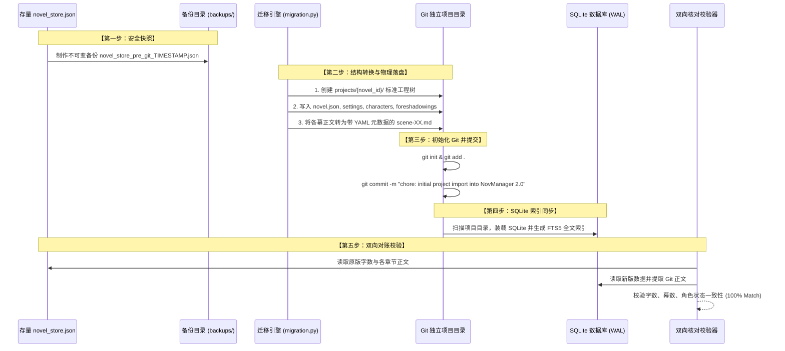

# NovManager 2.0 数据与架构无缝迁移实施方案 (Migration Plan)

## 一、 迁移目标与质量承诺

本次迁移旨在将现有的集中式 JSON / PostgreSQL 存储平滑转换为 **“各作品独立 Git 仓库 + 本地 SQLite 高速索引”** 的全新 2.0 架构。

### 质量硬性指标
1. **零数据丢失（Zero Data Loss）**：现有作品（包括《太虚纪元》13 章节全量工笔正文、登场人物状态机流、伏笔追踪、文风技巧库）100% 完整迁移；
2. **字符级精准对账**：正文字数与内容哈希值迁移前后严格保持一致（差异为 0 字符）；
3. **接口无缝后向兼容**：FastAPI REST 接口与 MCP 协议接口路径、入参、出参完全保持兼容，前端 Web UI 与外部 Agent（Cursor、Claude Desktop）无需修改任何代码；
4. **可逆回滚保障**：迁移前自动生成时间戳只读备份快照，若遇异常一键瞬时回滚。

---

## 二、 现有存量数据资产审计 (Baseline Audit)

基于当前 `backend/data/novel_store.json` 的全量数据普查：

| 数据实体 | 存量规模 | 目标物理映射位置 |
| :--- | :--- | :--- |
| **小说主体 (`novels`)** | 3 部作品：<br/>• `nov-001` (太虚纪元，6.8万字)<br/>• `nov-002` (天演寻真录，1.4万字)<br/>• `nov-1788545508525` (九霄封神志) | `backend/data/projects/{novel_id}/novel.json` |
| **分卷与章节 (`volumes` / `chapters`)** | 卷 1 部，章节 13 章 | `manuscript/volume-01/chapter-XXX/chapter.json` |
| **分镜幕正文 (`scenes`)** | 13 个核心分镜幕正文 | `manuscript/volume-01/chapter-XXX/scene-01.md` (带 YAML 头) |
| **世界观设定 (`world_settings`)** | 8 条完整词条（修行境界、太虚青铜片、神魂誓等） | `settings/*.json` |
| **人物核心卡 (`characters`)** | 4 位角色（林越、苏青瑶、陈长老、黑煞教血灵道人） | `characters/char-XXX.json` |
| **人际关系网络 (`relations`)** | 2 条动态好感关系 | `relations.json` |
| **逐章状态机 (`character_states`)** | 2 条多章节状态演进记录 | `characters/states.jsonl` |
| **伏笔追踪 (`foreshadowings`)** | 2 条暗线线索（逆向铭文、剑鞘卡槽） | `foreshadowings.json` |
| **文风润色技法 (`polish_techniques`)** | 已沉淀的修辞与节奏技巧库 | `techniques.json` |

---

## 三、 迁移六步走实施步骤 (Step-by-Step Roadmap)



### 第一步：制作防毁快照备份
在任何写入动作前，将现有 `novel_store.json` 完整复制至 `backend/data/backups/novel_store_backup_{YYYYMMDD_HHMMSS}.json`，并设置为只读权限。

### 第二步：实现基础设施模块代码
1. **`backend/app/git_manager.py`**：
   - 封装原生 Git 子进程异步执行函数；
   - 提供 `init_repo()`, `commit_all()`, `get_history()`, `get_diff()` 纯净 API。
2. **`backend/app/file_system.py`**：
   - 实现 `NovelFileSystem`，负责把内存实体对象写入 Markdown/YAML 与 JSON，或从磁盘解析还原为 Pydantic 模型。
3. **`backend/app/db.py` 重构**：
   - 消除特定的 PostgreSQL 方言（如 `JSONB` 替换为通用 `JSON`）；
   - 默认切换为 `sqlite:///./backend/data/novmanager.db?check_same_thread=False`，自动启用 WAL 并发日志模式。

### 第三步：执行自动化迁移脚本 (`scripts/migrate_to_git_projects.py`)
针对 `nov-001`、`nov-002` 及其他作品循环执行：
1. 创建 `backend/data/projects/{novel_id}/`；
2. 写入 `novel.json`（书名、文风准则、字数目标）；
3. 递归写入 `manuscript/volume-XX/chapter-YYY/scene-ZZ.md`；
4. 写入人物卡与 `characters/states.jsonl`；
5. 写入伏笔与文风技巧；
6. 在该目录下执行：
   ```bash
   git init -b main
   git config user.name "NovManager"
   git config user.email "system@novmanager.local"
   git add .
   git commit -m "feat(migration): 存量小说工程化迁移初次落盘"
   ```

### 第四步：构建 SQLite 数据库与 FTS5 索引
由 `DatabaseManager` 从新生成的 Git 文件树一键执行 `reindex`，装配所有表格数据并为正文构建全文检索加速。

### 第五步：自动化对账校验（Verification Script）
编写自动化对账断言：
```python
def test_verify_migration():
    # 1. 验证作品数量相等
    # 2. 验证每一章每一幕的 draft_content 字符内容 100% 相同 (diff 长度为 0)
    # 3. 验证总字数统计精确相符
    # 4. 验证角色状态机与好感度条数完全一致
    # 5. 验证已沉淀的润色技巧条数与频次无损迁移
```

### 第六步：切换 `NovelRepository` 仓储外观底座
更新 `backend/app/storage.py`，让所有业务调用直接对接新的双轨持久化引擎，运行现有 `pytest backend/tests/` 确保所有 API 与 MCP 接口自动化测试一次性绿灯通过。

---

## 四、 回滚与应急恢复预案 (Rollback Plan)

若迁移过程中出现任何非预期错误：
1. **一键还原**：删除 `backend/data/projects/` 新目录，从 `backend/data/backups/` 中恢复原 `novel_store.json`；
2. **零副作用**：现有前端与后端完全兼容原 `novel_store.json`，随时可无缝切换回原架构；
3. **系统保证**：整个迁移过程不影响当前运行的 Web 前端开发服务器与后端服务。
